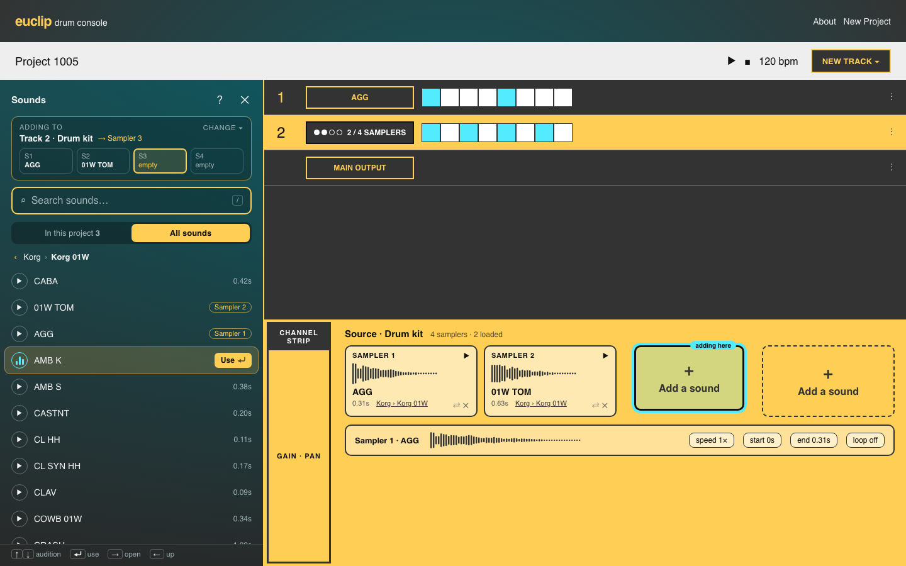
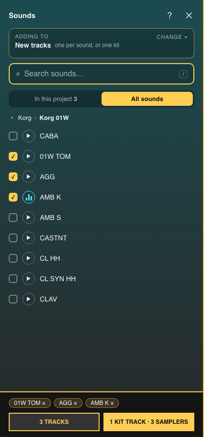
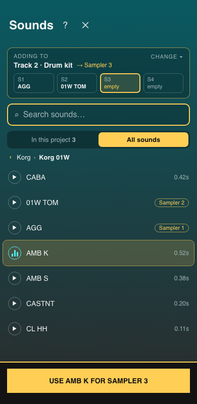

# Sample browser, sample pool and sampler assignment: UX review and redesign proposal

Status: proposal, nothing implemented. Follows `snapshots-and-sample-pool.md` (decision 4 there: "uploads come later, after the
file browser is refactored"; this is that refactor).
Audience: the project owner, and whoever builds it.
Method: every flow below was walked in the running app (Playwright, 1440x900 and 390x800) with a screenshot at each step, then
compared with the code. Screenshots are in `img/sample-ui/current-*.png`; the proposed design is in `img/sample-ui/proposed-*.png`
(rendered from `img/sample-ui/mock/*.html`, which are static mocks in the app's palette, not working code).

## 1. Summary

The left sidebar does four jobs at once (browse the catalog, search it, manage the project's sample pool, create tracks from
files) and is wired to three other places that say the same things (the track row's source button, the footer's Source tab with
its path "breadcrumb", and the footer's sampler tabs). The user has to hold a mental model of *modes* and *slots* that the screen
never states, and the commonest task, filling the samplers of a kit, costs **10 clicks (12 counting the kit's creation) with no way to hear a sound first**.

The proposal:

1. **One browser, one target.** The sidebar becomes a "Sounds" browser with an always-visible *target* ("Adding to Track 2 · Sampler 3").
   The two radio-button modes, the duplicated sampler tabs and the separate Pool tab go away.
2. **Audition by navigating.** Arrow keys (or a click on a row) play a sound; **Use** (or Enter) assigns it and moves the target to
   the next empty sampler. Filling a 4-sampler kit drops from 10 clicks to 7 without auditioning (each audition is one ▶ click, or just ↓), and to a handful of key presses on the keyboard.
3. **Samplers become first-class in the footer.** The Source tab shows a rack of sampler cards (name, waveform, duration, ▶, change, clear)
   instead of a row of identical "SAMPLER sampler1…4" tabs plus a path breadcrumb.
4. **"In this project" replaces the Pool tab** as a shelf in the same browser, so reusing a sound is the same gesture as picking a new one.
5. **Creating tracks from sounds is a target, not a mode.** Multi-select shows a tray with "N tracks" or "1 kit track · N samplers".

## 2. Flows walked, and what they cost today

Clicks are the minimum for someone who knows the app, measured from a fresh project. Folder position is remembered per track, so
a second sampler from the same folder skips the drilling.

| # | Flow | Steps today | Clicks | Screens |
|---|---|---|---|---|
| A | Pick a sample for a new track's sampler | row "Pick a Sound" → Korg → Korg 01W → AGG | 4 | `current-02`, `-04`, `-05` |
| B | Create a multi-sample kit and give all four samplers a sound | New Track ▾ → Multi-sample kit → row button → (Korg → Korg 01W → pick) → [sampler tab → pick] ×3 | 2 + 1 + 3 + 6 = **12** (10 from the row button on) | `current-10`, `-11`, `-14` |
| C | Put a sample from the pool on an open slot | open sidebar → Sample Pool tab → "Slot 3" on the sample | 3 (but only after the sample reached the pool by having been picked once) | `current-17` |
| D | Click a `pathSegments` button in the Source tab | Source tab → "Korg 01W" | 2; opens the sidebar on that folder. **Does nothing visible if the sidebar is already there** | `current-07` |
| E | Choose which sampler of a kit you are editing | footer sampler tab, *or* sidebar sampler tab (kept in sync) | 1 | `current-11`, `-14` |
| F | "Add to current track" vs "Create multiple tracks" | radios at the top of the sidebar; or New Track ▾ → Drum Machine | 2 to switch, 5+ to make 3 tracks | `current-21` |
| G | Search | type ≥3 characters, click a result | 2 (the best-designed path in the app) | `current-24` |

Search (G) is the model to copy: flat results, grouped by machine, one click to assign.

## 3. Findings

### 3.1 Structure and mental model

1. **Four ways in, three overlapping surfaces.** The row's source button, the Source tab's "Pick a Sound" link, the pathSegments
   buttons and the New Track ▾ → Drum Machine entry all open the same sidebar in slightly different states. Inside it, sampler tabs
   (also shown in the footer) and a breadcrumb (also shown, as pathSegments, in the footer) repeat state that already lives elsewhere.
2. **Modes that rearrange the whole panel.** "Create multiple tracks" removes the Pool/Browse tabs and the sampler tabs, changes the
   title, adds checkboxes and a floating button (`current-21`). Because it is a radio at the top of the sidebar it reads as a
   persistent setting; because New Track ▾ → Drum Machine also sets it, there are two doors to one state.
3. **The target is implicit.** Which sampler receives the sound is shown only by which sampler tab is highlighted, and in a 420px sidebar
   the third and fourth sampler tabs are clipped off the right edge (`current-11`, `-14`). With a single sampler there is no hint at all.
4. **Vocabulary drifts.** The same thing is called *slot* (pool buttons), *sampler* (the footer tabs are labelled "SAMPLER" with the
   node id underneath, so a kit reads SAMPLER ×4, and the screenshots below show the older ids `pad1…4`, since renamed `sampler1…4`),
   *sample* (the kit button says "4 SAMPLES" when none are loaded, `current-10`), *sound* ("Pick a Sound", "Sounds" column header)
   and *file*. The catalog's top level is headed "Drum Machine" and its second level "Drum Machine" too.

### 3.2 Browsing

5. **No audition.** `previewAudioFile()` exists in `drum-file-sidebar.ts` but no template calls it; the only ▶ in the app is in
   the Pool. Picking a sound *is* assigning it: it saves, rebuilds the audio graph and replaces the sampler's previous sample. There is
   no way to hear before committing and no undo.
6. **Miller columns in a 420px panel.** Opening a folder adds a column to the right and the list scrolls horizontally, so the parent
   column ends up as an empty strip with an orphan yellow bar (`current-04`, `-05`). On a phone it is 1.2 columns wide
   (`current-23`). The depth is fixed (machine brand → model → sounds), the root is a flat alphabetical list of ~90 brands.
7. **One colour, three meanings.** Yellow marks the keyboard cursor (always the *first* row even when nothing is selected:
   "505, 707 & 727", "CABA"), the selected file (AGG) and the primary action. Hover is dark. Result: two yellow rows at once, or
   a "selected" row nobody selected.
8. **Chrome eats the list.** Title, info button, close, tabs, sampler tabs, search, two radios and the breadcrumb stack above the list:
   about 290px of 727 for one sampler and 350px (48%) for a kit before the first file appears. The breadcrumb is dark grey 12px on
   dark teal (`current-04`), the one piece of navigation people need.
9. **Unstyled controls.** Native radios and checkboxes (blue, 13px) sit in a yellow-on-teal theme; the Pool/Browse tabs are
   underline-style while the sampler tabs below them are pills.
10. **The "Create 3 tracks" bar covers the last list row** (`current-21`) and selections made in one folder are not visible from another.

### 3.3 Assigning

11. **Kit filling has no flow.** After picking a sound for sampler 1 nothing advances: the user clicks a sampler tab, then a sound, per
    sampler. Sampler tabs do not say what is in each sampler, so you cannot tell which are empty without opening each.
12. **The Pool is a second, separate world.** Samples get into it only as a side effect of being picked in Browse; you then switch
    tab to reuse them. Assignment is an N×M matrix of "Slot n" micro-buttons (8 samples × 4 slots = 32 buttons, 11px, `current-17`);
    previewing, renaming and removing live on the same dense row.
13. **pathSegments looks like text, acts like links, and duplicates the sidebar's breadcrumb.** Clicking it with the sidebar
    already open produces no visible change (`current-07`), so it feels broken.
14. **Status is invisible.** There is no "assigned" confirmation beyond the row label changing; errors (download failed) are a red
    word in the pool or a beacon dot on the row.

### 3.4 Small screens

15. Full-screen sidebar is the right idea (done), but on 390px the list begins 44% down the screen, the tab strip scrolls
    horizontally, and each assignment is still a tiny row tap with no confirm.

## 4. Design principles

1. **Say where the sound is going, always** (the target), and let the target change without leaving the list.
2. **Hear first, commit second.** Browsing plays; assigning is a separate, explicit, undoable step.
3. **Same list for everything.** Catalog, search results and the project's own sounds are the same row component.
4. **State lives where it belongs.** What a sampler holds is shown in the sampler rack, once. The browser shows only the target.
5. **Intent, not modes.** "Make tracks" vs "fill a sampler" is the target's value, not a setting that rebuilds the panel.
6. **One selection language.** Yellow = the target/selection. Hover = lighter surface. Focus = ring. Playing = animated bars.

## 5. Proposed design



### 5.1 The browser (left sidebar, "Sounds")

```
┌ Sounds ──────────────────────── ? ✕ ┐
│ ADDING TO                    change ▾│   target card: where the next "Use" goes
│ Track 2 · Drum kit → Sampler 3       │
│ [S1 AGG][S2 01W TOM][S3 ◻][S4 ◻]     │   the samplers, filled state at a glance;
│                                      │   click one to retarget
│ ⌕ Search sounds…                   / │   search-first, focus with "/"
│ [ In this project 3 | All sounds ]   │   segmented control (replaces the Pool tab)
│ ‹  Korg › Korg 01W                   │   readable breadcrumb + up
│ ▶ CABA                         0.42s │
│ ▶ 01W TOM                  Sampler 2 │   badges show where a sound already lives
│ ▶ AGG                      Sampler 1 │
│ ◉ AMB K                    [Use ⏎]   │   selected + playing; Use assigns
│ ▶ AMB S                        0.38s │
│ ↑↓ audition  ⏎ use  → open  ← up     │
└──────────────────────────────────────┘
```

- **Single column drill-down** (folder rows with a chevron, ‹ to go up) instead of Miller columns. Full-width rows, 42px high.
- **Row interactions.** Clicking a row or ↑/↓ selects *and plays* it (cancelling the previous preview); ▶ plays without selecting.
  **Use** appears on the hovered, focused or selected row, so a user who already knows the sound commits in one click without auditioning.
  Use / Enter / double-click assigns to the target and **advances the target to the next empty sampler** (with a short "Sampler 3 ← AMB K" confirmation and Undo).
  → / Enter on a folder opens it; ← goes up; `/` focuses search.
- **Search** keeps today's grouped-by-machine results, adds ▶ and Use to each row, and appears under the same target card.
- **In this project** (the pool) is the same list with sounds the project already uses; badges show "Sampler 2 · Track 1". Rename,
  remove and "used by" move to a row menu (⋯). Removal stays disabled while a track uses the sound.
- **No radios, no mode.** The target card has a menu: *Track 2 · Sampler 1…4*, *New track*, *New kit*.
- **Empty and error states:** "No sounds match", a retry row for a failed listing, an inline "couldn't load" on a row whose download failed.

### 5.2 Creating tracks from sounds (replaces "Create multiple tracks")



New Track ▾ gains **From sounds…**, which opens the same browser with the target set to *New tracks*. Checkboxes appear in that target
(or after ⇧/⌘-click anywhere), selections persist across folders and show as chips in a bottom tray, which is a layout row, not an
overlay. Two actions, because both are common: **N tracks** (one sampler each, today's behaviour) and **1 kit track · N samplers** (new).

### 5.3 Samplers in the Source tab (footer)

The footer's Source tab replaces the "SAMPLER sampler1…4" pills + path breadcrumb + "Pick a Sound" link with a **sampler rack**:

```
Source · Drum kit                      4 samplers · 2 loaded
┌ SAMPLER 1     ▶┐ ┌ SAMPLER 2     ▶┐ ┌ SAMPLER 3 ·····┐ ┌ SAMPLER 4 ·····┐
│ ▂▅▇▅▃▂▁         │ │ ▂▆▇▆▄▃▂▁       │ ╎       ＋        ╎ ╎       ＋        ╎
│ AGG             │ │ 01W TOM        │ ╎  Add a sound    ╎ ╎  Add a sound    ╎
│ 0.31s Korg›Korg 01W  ⇄ ✕ │ │ …      │ └ ─ ─ ─ ─ ─ ─ ─ ┘ └ ─ ─ ─ ─ ─ ─ ─ ┘
└─────────────────┘ └────────────────┘   (dashed = empty; "adding here" ring on the target)
Sampler 1 · AGG ▂▂▅▇▅▃▂▁  speed 1×  start 0s  end 0.31s  loop off     ← the selected sampler's controls (today's controls)
```

- A card shows the sound's name, a small waveform, duration, **▶** (audition), **⇄ change** (retarget + open the browser) and **✕ clear**.
- Clicking a card selects the sampler (the controls below follow, replacing the node tabs); clicking an empty card opens the browser with that sampler as the target.
- The tiny "Korg › Korg 01W" caption replaces pathSegments: one control, with one meaning, **Show in browser** (opens the browser at that folder and, if it is already open there, flashes the row).
- The track row's source button stays one button but tells the truth about a kit: `●●○○ 2 / 4 samplers` (single sampler: the filename). Clicking it opens the browser on the first empty sampler (or the selected one).
- Drag a sound from the browser onto a sampler card or a track row (later, section 8 phase 4) for the direct-manipulation path.

### 5.4 Phone



Full-screen browser (as now) with the target pinned at the top, the list in the remaining space, and a **single large "Use AMB K for sampler 3" button** in a bottom sheet instead of per-row targets. The sampler strip is four chips that always fit (no horizontal tab scrolling). Search sits above the list and the segmented control keeps both shelves one tap apart.

### 5.5 Vocabulary

| Use | Instead of |
|---|---|
| **Sound** (a catalog item) | file, sample (in the catalog) |
| **Sampler** (one sampler node on a track; "Sampler 1…4" on a kit) | slot, the "SAMPLER sampler1" tab label |
| **In this project** (the shelf) | Sample Pool |
| **Adding to** (the target card) | "Select Sampler For Track 2" |
| **Kit** (a track with several samplers) | multi-sample |

### 5.6 Visual rules

- Rows: 42px, text `--light-gray`; folders white with a › chevron; durations and badges in a muted tone. Folder and sound rows share a left edge.
- Selection = `--yellow` outline and tint; hover = 8% white; focus-visible = the existing blue ring; **no persistent cursor row**.
- Breadcrumb 13px in `--light-gray`; the current folder bold.
- Replace native radios and checkboxes with the app's 18px yellow checkbox; remove the radios altogether.
- Motion: the target ring on the sampler card and the playing bars are the only animations; both respect `prefers-reduced-motion`.

### 5.7 Keyboard and accessibility

- The list is a `role="listbox"` (folders and sounds as `option`s) with a roving `aria-activedescendant`; ↑↓ move, → open, ← up, Enter use, Space audition/stop, `/` search, Esc closes.
- The target card is a labelled region; assignments and target changes are announced through an `aria-live="polite"` region ("Sampler 3 set to AMB K. Next: Sampler 4").
- Sampler cards are buttons with names like "Sampler 1: AGG, 0.31 seconds"; empty cards say "Sampler 3: empty. Add a sound".
- Every icon-only control keeps a text alternative (the ▶ per row is "Audition AMB K").

## 6. Paths, before and after

```
TODAY  (pick one sample)                       PROPOSED
row Pick a Sound ─┐                            row source button ─┐
footer Pick link ─┼─► sidebar[Browse]          sampler card "＋" ─────┼─► Sounds browser, target = that sampler
pathSegments ─────┘      ├ drill ×2                              │      ├ search or drill   (audition as you go)
                          └ click file = commit                   │      └ Use ⏎  = commit, target → next empty sampler
                                                                  └─ "In this project" shelf: same list, same Use

TODAY  (kit, 4 samplers)  open · 3 drills · pick │ (tab · pick)×3 = 10 clicks, silent
PROPOSED              open · 2 drills · Use ×4 = 7 clicks (+1 per audition, or ↓); ≈ key presses with ↑↓⏎
PROPOSED (kit from a selection)   New Track ▾ · From sounds · 2 drills · tick 4 · "1 kit track" = 9 clicks, 1 new track with 4 samplers
                                   (today the same selection makes 4 separate tracks: radio · 2 drills · tick 4 · Create = 8 clicks, and no kit)

TODAY  (reuse a sound)        Pool tab · Slot n               PROPOSED   "In this project" · Use
TODAY  (make tracks)          radio · drill · tick · Create    PROPOSED   target "New tracks" · tick · "N tracks" / "1 kit"
```

(The click counts are minima, with the folder already open on the sounds you want.)

## 7. What to change in the code

| Area | Today | Change |
|---|---|---|
| `components/file-picker/drum-file-sidebar.{hbs,ts}` | tabs, sampler tabs, mode radios, three layouts | one layout: target card, search, segmented control, list, tray |
| `components/file-picker/{selection,file-directory,breadcrumbs}` | Miller columns | single-column list with breadcrumb/up; keep `data-test-file-breadcrumb` |
| `components/file-picker/mode-selector.hbs` | radios | delete; target menu replaces it |
| `components/project/sample-pool.{hbs,js}` | separate tab, slot matrix | becomes the "In this project" source for the same list; row menu for rename/remove |
| `components/source/{container,node-tabs}` | sampler pills + pathSegments + "Pick a Sound" | sampler rack (new component) + "Show in browser" caption |
| `components/source-select-button.*` | "4 SAMPLES" | `●●○○ 2 / 4 samplers`; opens on the first empty sampler |
| `components/project/ui-state.ts` | `leftTab`, `audioSelectMode`, `selection {trackId, idx}` | `selection` already *is* the target: promote it to `target: {kind: 'sampler', trackId, idx} \| {kind: 'new-tracks' \| 'new-kit'}`; drop `audioSelectMode`, keep `leftTab` only as the shelf |
| `services/sample-pool.ts` | `preview(sample)` for pool rows | add `previewPath(path)` for catalog sounds: reuse `SoundFile.findOrDownload`, decode once, cancel the previous preview, small concurrency cap |

Foundations that already exist and make this cheaper than it looks: the shared node selection in `ui-state`, `track.setFile(slot, path)`,
`samplePool.preview`, `AudioFileTreeModel.fetchDirectory({search})`, and the grouped search results.

## 8. Phases

0. **Quick wins (no new structure, about a day):** wire audition into the current list; one selection style and remove the
   persistent first-row cursor; readable breadcrumb; kit button "2 / 4 samplers"; sampler tabs wrap instead of scrolling and show the
   sound name; auto-advance to the next empty sampler after a pick; make the pathSegments caption flash/scroll when the sidebar is already there.
1. **Browser rewrite:** single-column list, target card, segmented "In this project / All sounds", row actions, undo; remove the mode radios; "From sounds…" in New Track ▾ with the selection tray (N tracks / 1 kit).
2. **Sampler rack** in the Source tab; remove the footer sampler pills and pathSegments; pool management moves to the row menu.
3. **Uploads** (plan decision 4): "My uploads" as a third source in the same segmented control, a drop zone on the list, and an origin on pool entries.
4. **Direct manipulation:** drag a sound onto a sampler card, a track row or the "New track" button; thumbnails and durations from a catalog index.

## 9. Impact on tests

The e2e suites that touch this area (`file-browser.spec.ts`, `files.spec.ts`, `sample-pool.spec.ts`, `track-types.spec.ts`) depend on `data-test-*`
attributes (`source-sample`, `file-breadcrumb`, `pool-sample`, `pool-use`, `source-kind`) and on the Slot/sampler tab structure. Keep the ids
where the concept survives (breadcrumbs, source kind, pool rows) and port the slot-button tests to "target a sampler, press Use". The
Samples button in the project bar was removed in this session, so `sample-pool.spec.ts` already needs the same port.

## 10. Open questions

1. **Does the catalog have durations and categories?** The list in the mock shows durations; today only a directory listing is
   returned. Without metadata, show the duration after the first audition and keep browsing by machine. A catalog index (name, duration,
   kind: kick/snare/hat…) would also allow filter chips and category-first browsing.
2. **Should picking autosave without undo, as now?** Snapshots autosave by decision 1 of the plan; an Undo toast after *Use* is cheap and removes the fear of auditioning near a live sampler.
3. **Kit from selection:** is one track with N samplers (new) the right default over N tracks (today)? The mock offers both.
4. **Audition while the sequencer plays:** route previews to a separate bus at reduced level (the pool's preview path already bypasses the track graph) and show the playing row.
5. **Where do project-level sound operations live** (rename, remove unused, replace everywhere)? A row menu in "In this project" is the minimum; a "Manage" sheet is the next step if the pool grows.
